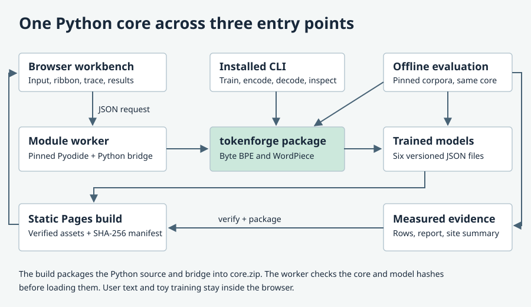

# TokenForge

Byte-level BPE and WordPiece, implemented from scratch in Python and checked against Hugging Face Tokenizers. Follow how a vocabulary is learned, inspect the bytes behind each token, and measure what survives decoding. The CLI, evaluation and interactive workbench run the same implementation.

[Inspect tokens](https://sashankpotluru.github.io/TokenForge/) · [Follow the training steps](https://sashankpotluru.github.io/TokenForge/#train) · [Explore the results](https://sashankpotluru.github.io/TokenForge/#results)

## What you can verify

BPE and WordPiece are established algorithms. TokenForge's engineering focus is making their training decisions, Unicode behavior and implementation correctness inspectable.

- **Training from first principles.** Deterministic pair selection, explicit tie-breaking and saved vocabularies. The training view shows actual pair counts and merge scores from the Python trainer. [Training implementation](src/tokenforge/training.py)
- **An optimized encoder with a reference check.** Byte BPE uses a heap to apply ranked merges; a simpler rescanning encoder provides an independent implementation to compare against. [BPE implementation](src/tokenforge/bpe.py) · [Core tests](tests/test_core.py)
- **Byte-level inspection.** Every token exposes its ID, source bytes and UTF-8 span. Unicode examples show how a character can span several tokens and how those bytes reconstruct the text. [Tokenizer contract](docs/tokenizer-contract.md)
- **Correctness checked against another runtime.** Each of the six learned models matched Hugging Face token IDs on **2,903 inputs**: 2,891 WikiText test rows, four CPython files and eight Unicode fixtures. This compares the same vocabulary and preprocessing in both implementations. [Evaluation protocol](docs/evaluation.md)
- **Reproducible evidence.** Pinned source revisions, model hashes, per-input observations and raw timing repetitions accompany the tables. Compression is reported alongside unknown coverage and reconstruction checks. [Report](results/report.json) · [Evidence verifier](benchmarks/evidence.py)

## A result worth inspecting

With 4,096-entry vocabularies, WordPiece emitted **86,657 tokens** on the four CPython files, compared with **100,493** for byte BPE. But WordPiece replaced **11.08% of pretokens** with `[UNK]` and discarded whitespace. Pretokens include punctuation, so this percentage is not a linguistic word-error rate. Byte BPE reconstructed every input exactly. Fewer tokens alone would give a misleading picture of this result. [Coverage and reconstruction measurements](results/site-summary.json)

In the workbench, choose **Unicode**, inspect a token's byte span, then switch to **WordPiece** to see whole-pretoken fallback. **Train** exposes the merge decisions. **Results** compares all six vocabularies on prose and Python source, including runtime measurements and their limitations.

## Quickstart

Use Python 3.12 or 3.13. The installed tokenizer has no third-party runtime dependencies.

```sh
git clone https://github.com/Sashankpotluru/TokenForge.git
cd TokenForge
python3 -m venv .venv
. .venv/bin/activate
python -m pip install -e .
printf 'tokenization' | tokenforge encode --model models/bpe-4096.json
```

The saved 4,096-entry BPE model yields these records for `tokenization`. Spans use half-open UTF-8 byte offsets.

| Piece | ID | Byte span | Hex |
| --- | ---: | --- | --- |
| `to` | 281 | [0, 2) | 746f |
| `ken` | 1675 | [2, 5) | 6b656e |
| `ization` | 2549 | [5, 12) | 697a6174696f6e |

```sh
printf '[281,1675,2549]' | tokenforge decode --model models/bpe-4096.json
printf 'tea tea teal' | tokenforge train --algorithm bpe --vocab-size 280 --output tea.json
tokenforge inspect --model tea.json
```

```python
from tokenforge import Tokenizer

model = Tokenizer.load("models/bpe-4096.json")
encoded = model.encode("café 🪶")
for token in encoded.tokens:
    print(token.id, token.piece, token.bytes_hex, token.start, token.end)
assert model.decode(encoded.ids) == encoded.normalized_text
```

Byte BPE starts with all 256 bytes and five reserved symbols. A ranked-merge heap encoder and a simple rescanning reference share the same model format. WordPiece uses a documented educational pair-scoring heuristic and greedy longest-match encoding. Its canonical decode collapses whitespace, separates punctuation and substitutes `[UNK]` for any unrepresentable pretoken. Marker strings such as `[MASK]` are literal input by default. The contract covers normalization, deterministic ties, explicit specials and model validation. [Tokenizer contract](docs/tokenizer-contract.md)

## What the measurements show

Each model trained independently on 540 WikiText rows totaling 249,386 UTF-8 bytes. Training excluded exact whole-row matches with the official test split. Evaluation used all 2,891 nonempty WikiText test rows and four CPython v3.13.0 source files. [Data selection and evaluation protocol](docs/evaluation.md)

| Model (4,096 entries) | Domain | Emitted tokens | Raw bytes/token | Unknown pretokens | Known bytes/known token |
| --- | --- | ---: | ---: | ---: | ---: |
| Byte BPE | WikiText | 618,418 | 2.082 | 0 | All bytes represented |
| WordPiece | WikiText | 720,989 | 1.786 | 0.15% | 1.441 |
| Byte BPE | CPython | 100,493 | 1.534 | 0 | All bytes represented |
| WordPiece | CPython | 86,657 | 1.778 | 11.08% | 1.267 |

Byte BPE reconstructed every source input. On the code files WordPiece emitted fewer tokens while losing over one in ten pretokens, which include punctuation. Raw bytes/token credits discarded whitespace and the source bytes covered by each unknown placeholder. The final column isolates represented non-whitespace bytes in the WordPiece rows. [Counts, reconstruction checks and coverage](results/site-summary.json)

Hugging Face Tokenizers returned the same ID sequence as TokenForge for each trained model on every held-out input. With the 4,096-entry BPE model, median WikiText throughput was **758,927 bytes/s** for the Python implementation and **1,294,512 bytes/s** for the Hugging Face adapter. Each figure comes from five warm, single-threaded passes on one Apple M4 Pro over a fixed 32-row subset. The comparison includes Python record construction and native runtime/interface differences. It measures execution of the same model. The separately pretrained `cl100k_base` reference uses a much larger vocabulary and different boundaries. [Timing protocol](docs/evaluation.md#runtime-protocol) · [Raw repetitions and machine metadata](results/report.json)

## Architecture



The Pages build verifies the recorded evidence, packages the Python sources and a fixed JSON bridge in a deterministic ZIP, and writes byte lengths and SHA-256 hashes for the bundle, models and summary. A module worker loads pinned Pyodide 0.29.3 from its CDN, verifies the assets it uses, then passes the request as data through Python globals. Cancellation terminates the worker. A subsequent run starts a fresh worker and ignores messages from the old request. [Build script](scripts/build_site.py) · [Worker runtime](web/runtime.mjs) · [Diagram source](docs/architecture.mmd)

Browser encoding accepts up to **12,000 Unicode scalars** and shows the first **160 tokens**. The token count, decode and context estimate use the complete encoding. Toy training accepts **1,000 scalars**, a minimum pair count of two and at most **12 merges**. The cost estimate uses an editable illustrative input rate. A deployed language model fixes its tokenizer and billing units. The browser needs network access to the Pyodide CDN on first load. Building the site from this checkout uses local files only.

## Run locally

```sh
python scripts/build_site.py
python -m http.server 8000 --directory site
```

Open [the local workbench](http://localhost:8000/). Serve it over HTTP on localhost or HTTPS for the browser’s module worker and cryptographic integrity checks. The site also works under a project path such as `/TokenForge/`.

## Reproduce or audit the evaluation

Audit the published model/report hashes and recompute aggregate counts from row observations with the core installed.

```sh
python -m benchmarks.evidence
```

For a new measurement, use a fresh checkout and Python 3.13.2 to match the recorded interpreter. The reproduction command downloads and verifies the pinned inputs, trains each of the six vocabularies, evaluates both domains and the separate Unicode stress fixtures, then replaces the generated models and reports. A populated cache supports `sh scripts/reproduce.sh --offline`. Measured times vary with hardware and software. [Complete protocol](docs/evaluation.md#reproduce)

```sh
python -m pip install -r requirements-benchmark.txt
python -m pip install -e .
sh scripts/reproduce.sh
```

| Location | Contents |
| --- | --- |
| [src/tokenforge](src/tokenforge) | BPE, WordPiece, trainer, schema validation, public API and CLI |
| [benchmarks](benchmarks) | Pinned source manifest, adapters, metrics and verification |
| [models](models) | Six deterministic JSON artifacts at 1,024, 2,048 and 4,096 entries |
| [results](results) | Report, compact site summary, training selection and gzipped per-row observations |
| [web](web) | Static interface, worker, Python bridge and Node tests |
| [tests](tests) | Core, property, CLI, adapter parity, evidence and build checks |

## Development checks

Run the Python tests in a development environment and use Node 22 or later for the browser protocol tests.

```sh
python -m pip install -r requirements-dev.txt -r requirements-benchmark.txt
python -m pip install --no-build-isolation --no-deps -e .
ruff check src benchmarks scripts tests web/bridge.py
mypy
python -m pytest -q
python scripts/build_site.py
node --test web/tests/*.test.mjs
```

CI runs the Python checks and an isolated wheel smoke test on both Python 3.12 and 3.13. A separate job builds the site and checks workbench assets and request handling. The main-branch release runs CI before deploying to GitHub Pages. [CI workflow](.github/workflows/ci.yml) · [Pages workflow](.github/workflows/pages.yml)

## Attribution

Original software is available under the MIT license. The six learned vocabularies derive from WikiText, authored from English Wikipedia contributions. The model files carry separate CC BY-SA 4.0 terms and preserve the upstream licensing notices. The evaluation uses CPython source under the PSF terms. [Software license](LICENSE) · [Dataset, model and dependency notices](THIRD_PARTY_NOTICES.md)
